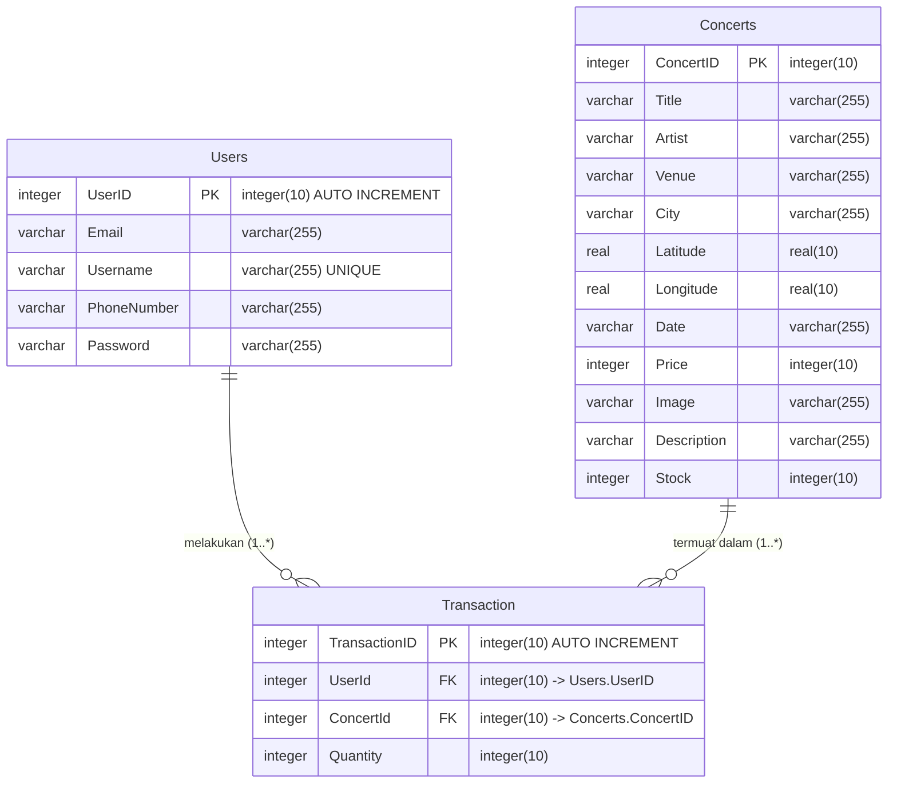
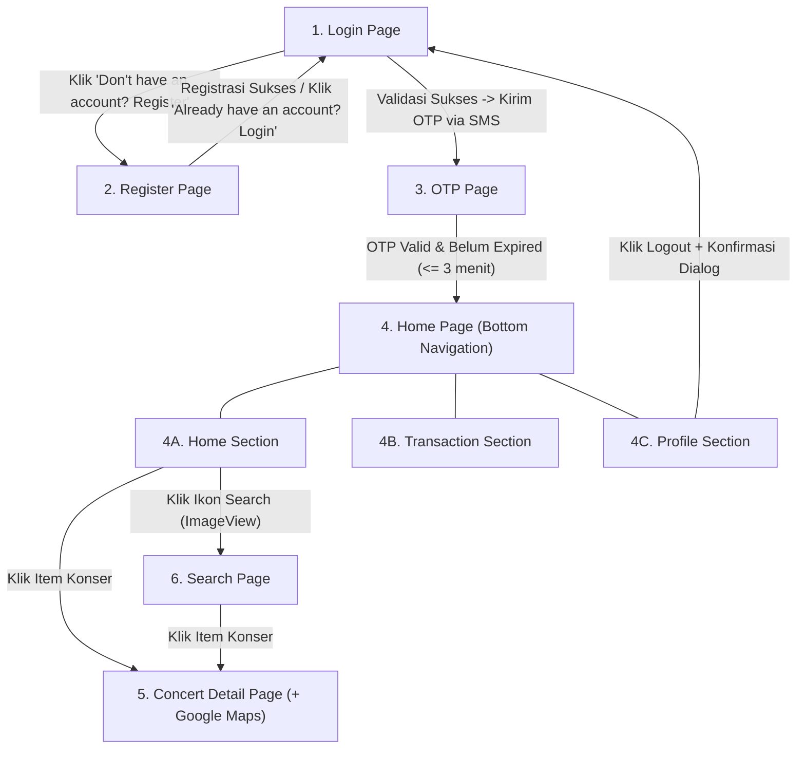

# Spesifikasi Requirement & Rencana Implementasi: ConcertX (COSC6103 - Mobile Technology Solution)

Dokumen ini memuat penjelasan mendetail mengenai seluruh kebutuhan (*requirements*), kriteria penilaian, arsitektur database, alur bisnis, serta rencana implementasi teknis untuk proyek praktikum **COSC6103 - Mobile Technology Solution (Semester Ganjil 2026/2027)** berdasarkan dokumen soal [O272-COSC6103-VB02-00.docx](file:///c:/Users/Ferdinand/Downloads/Tugas%20Kuliah/mts-lab-project/O272-COSC6103-VB02-00.docx), rubrik [COSC6103 - Material and Criteria PRY.pdf](file:///c:/Users/Ferdinand/Downloads/Tugas%20Kuliah/mts-lab-project/COSC6103%20-%20Material%20and%20Criteria%20PRY.pdf), dan [Template Documentation External.docx](file:///c:/Users/Ferdinand/Downloads/Tugas%20Kuliah/mts-lab-project/Template%20Documentation%20External.docx).

---

## 1. Gambaran Umum Proyek (Goal Description)

**ConcertX** adalah aplikasi mobile berbasis **Android (Kotlin)** yang membantu pengguna menemukan, menjelajahi, dan membeli tiket konser musik *live* di berbagai kota dan *venue* di Indonesia.

Fitur utama yang wajib dibangun meliputi:
1. **Autentikasi Berlapis (Login, Register & 2FA OTP via SMS):** Registrasi pengguna baru dan login yang dilanjutkan dengan pengiriman kode OTP 6 digit menggunakan **Android SMS Manager API**.
2. **Sinkronisasi Data Konser (Web Service & SQLite):** Mengambil data konser dari REST endpoint JSON menggunakan pustaka **Volley**, mem-parsing datanya, dan menyimpannya ke dalam database lokal **SQLite**.
3. **Eksplorasi & Pencarian Konser:** Menampilkan daftar konser menggunakan `RecyclerView` dan fitur pencarian lokal secara *real-time* berdasarkan judul konser (*title*), artis (*artist*), atau kota (*city*).
4. **Detail Konser, Peta Lokasi & Pembelian Tiket:** Menampilkan informasi lengkap konser, peta lokasi *venue* menggunakan **Google Maps SDK**, serta form pembelian tiket yang memotong stok tiket secara langsung di database lokal.
5. **Manajemen Transaksi (CRUD):** Menampilkan daftar transaksi milik pengguna yang sedang login, mengubah jumlah tiket (*Update*), dan membatalkan/menghapus transaksi (*Delete* dengan dialog konfirmasi).
6. **Manajemen Sesi & Profil Pengguna:** Menampilkan profil pengguna secara *read-only* dan fitur *Logout* dengan dialog konfirmasi.

---

## 2. Ketentuan Umum, Software & Kriteria Penilaian

### A. Spesifikasi Lingkungan & Pengumpulan
* **Bahasa Pemrograman:** Kotlin (Android Native - XML Views)
* **Target Software:** Android Studio Quail 1 (2026.1.1) & **Android SDK API 37**
* **Bobot Nilai Proyek:** **100%** dari nilai akhir praktikum
* **Deliverables (File yang Dikumpulkan):**
  1. Seluruh folder project Android Kotlin (`Class`, `XML`, dan `Asset Files` seperti [lany.jpg](file:///c:/Users/Ferdinand/Downloads/Tugas%20Kuliah/mts-lab-project/asset/lany.jpg), [niki.jpg](file:///c:/Users/Ferdinand/Downloads/Tugas%20Kuliah/mts-lab-project/asset/niki.jpg), [tulus.jpg](file:///c:/Users/Ferdinand/Downloads/Tugas%20Kuliah/mts-lab-project/asset/tulus.jpg)).
  2. File **External Documentation** (`*.doc` / `*.docx` sesuai [Template Documentation External.docx](file:///c:/Users/Ferdinand/Downloads/Tugas%20Kuliah/mts-lab-project/Template%20Documentation%20External.docx)) yang berisi judul proyek, penjelasan aplikasi, *screenshot* setiap halaman beserta penjelasannya, link referensi aset, dan daftar anggota kelompok (NIM & Nama).

### B. Rincian Rubrik Penilaian (Total 100 Poin)

| Kategori Kriteria | Sub-Kriteria | Bobot Poin | Fokus Penilaian Praktikum |
| :--- | :--- | :---: | :--- |
| **1. UI Components** | Completeness (`07`) Appropriateness (`08`) | **15** | Kelengkapan seluruh halaman & komponen (`EditText` dengan `inputType` yang tepat, `Button`, `TextView`, `ImageView`, `RecyclerView`, `BottomNavigationView` dengan `menu` resource) serta kerapian tata letak. |
| **2. SQLite Local Database** | Configuration (`05`) CRUD Operation (`05`+`05`=`10`) | **15** | Konfigurasi `SQLiteOpenHelper`, pembuatan 3 tabel sesuai ERD (`Users`, `Concerts`, `Transaction`), serta operasi Insert, Select, Update, dan Delete. |
| **3. Google Map API** | - | **10** | Integrasi Google Play Services Maps SDK pada **Concert Detail Page**, peletakan *Marker* pada koordinat `Latitude` & `Longitude` konser, dan penamaan *Marker* sesuai nama *Venue*. |
| **4. Android SMS API** | - | **15** | Penggunaan `SmsManager` untuk mengirim kode OTP 6 digit acak ke nomor telepon pengguna saat Login dan saat menekan *Resend Code*. |
| **5. Web Service** | Fetch Data (`05`) Parse Data (`10`) | **15** | Pengambilan data JSON dari URL Gist menggunakan **Volley**, parsing atribut JSON, dan penyimpanan ke tabel `Concerts` di SQLite. |
| **6. Logic and Action** | - | **25** | Seluruh validasi input, aturan OTP (expired 3 menit, cooldown 30 detik, maks 3x resend), pengurangan stok tiket, state tombol *Buy* (disabled/enabled), dialog konfirmasi Delete/Logout, pencarian *case-insensitive*, dan manajemen sesi. |
| **7. External Documentation** | - | **05** | Kelengkapan dokumen eksternal sesuai template resmi. |
| **TOTAL** | | **100** | |

---

## 3. Arsitektur Database SQLite & Integrasi Web Service

### A. Skema Entity-Relationship Diagram (ERD)
Aplikasi wajib menggunakan **SQLite** dengan 3 tabel yang saling berelasi seperti berikut:

> [!IMPORTANT]
> Perhatikan bahwa nama tabel transaksi pada ERD adalah `Transaction` (kata kunci reservasi di SQL). Saat menulis query SQLite (`CREATE TABLE`, `INSERT`, `SELECT`, `UPDATE`, `DELETE`), nama tabel **`"Transaction"`** atau **`[Transaction]`** harus dibungkus tanda kutip/kurung siku agar tidak menyebabkan *SQL syntax error*.

### B. Spesifikasi Web Service (JSON API via Volley)
* **Endpoint URL:**
  `https://gist.githubusercontent.com/axelkrnwn/31139c9cfee4aca4acee3a36907a8c7e/raw/f4be1d6783d4331363e92b1bc450bf77259ea07c/concertx.json`
* **Library Wajib:** `com.android.volley:volley`
* **Struktur Data JSON & Pemetaan Aset Lokal:**
  Endpoint mengembalikan JSON Array berisi 3 konser yang berkorespondensi langsung dengan file gambar di folder [asset/](file:///c:/Users/Ferdinand/Downloads/Tugas%20Kuliah/mts-lab-project/asset):

| `concertId` | `title` | `artist` | `venue` | `city` | `latitude` | `longitude` | `date` | `price` | `image` | `stock` | Aset Gambar Lokal |
| :---: | :--- | :--- | :--- | :--- | :---: | :---: | :---: | :---: | :---: | :---: | :--- |
| `1` | Lany: A Beautiful Blur World Tour | Lany | Indonesia Arena | Jakarta | `-6.2153` | `106.8036` | `2026-10-29` | `1500000` | `"lany"` | `200` | [lany.jpg](file:///c:/Users/Ferdinand/Downloads/Tugas%20Kuliah/mts-lab-project/asset/lany.jpg) |
| `2` | NIKI: Buzz World Tour | NIKI | Jogja Expo Center | Jogjakarta | `-7.7956` | `110.3865` | `2026-07-04` | `950000` | `"niki"` | `150` | [niki.jpg](file:///c:/Users/Ferdinand/Downloads/Tugas%20Kuliah/mts-lab-project/asset/niki.jpg) |
| `3` | Tulus: Manusia Tour | Tulus | Grand City Convex | Surabaya | `-7.2575` | `112.7521` | `2026-05-01` | `450000` | `"tulus"` | `100` | [tulus.jpg](file:///c:/Users/Ferdinand/Downloads/Tugas%20Kuliah/mts-lab-project/asset/tulus.jpg) |

> [!TIP]
> Ketiga file gambar (`lany.jpg`, `niki.jpg`, `tulus.jpg`) ditempatkan di folder `app/src/main/res/drawable/`. Karena field `"image"` di JSON bernilai `"lany"`, `"niki"`, dan `"tulus"`, aplikasi dapat memuat gambar secara dinamis menggunakan `resources.getIdentifier(concert.image, "drawable", packageName)`.
> Selain itu, saat mengambil data dari Volley ke SQLite, pastikan data hanya di-*insert* jika `ConcertID` belum ada di tabel `Concerts` (atau ketika tabel masih kosong) supaya pengurangan `Stock` akibat transaksi pembelian tiket tidak ter-reset saat pengguna kembali ke *Home Section*.

---

## 4. Rincian Mendetail Setiap Halaman & Aturan Bisnis

Berikut adalah alur navigasi antarhalaman beserta spesifikasi komponen UI, validasi, dan aksi yang wajib dipenuhi:

---

### Halaman 1: Login Page
Halaman untuk mengautentikasi pengguna sebelum masuk ke verifikasi OTP.

* **Komponen UI Wajib:**
  * `EditText` **Username** (`inputType="text"`)
  * `EditText` **Password** (`inputType="textPassword"`)
  * `Button` **Login**
  * `TextView` bertuliskan **`"Don't have an account? Register"`** (mengarahkan ke **Register Page** saat diklik).
* **Validasi & Logika Tombol Login:**
  1. **Username wajib diisi** (*must be filled*).
  2. **Password wajib diisi** (*must be filled*).
  3. **Username dan Password harus terdaftar** di tabel `Users` pada database SQLite.
  4. **Penanganan Error:** Jika salah satu validasi gagal, tampilkan pesan error yang sesuai menggunakan **`Toast`**.
  5. **Jika Validasi Berhasil:**
     * Buat kode **OTP 6 digit angka acak** (contoh: `100000`–`999999` atau `String.format("%06d", Random.nextInt(1000000))`).
     * Kirim kode OTP tersebut menggunakan **Android SMS Manager API (`SmsManager`)** ke nomor telepon (`PhoneNumber`) pengguna yang terdaftar di database.
     * Arahkan (*redirect*) pengguna ke **OTP Page**.

---

### Halaman 2: Register Page
Halaman formulir pendaftaran pengguna baru untuk disimpan ke tabel `Users` di SQLite.

* **Komponen UI Wajib:**
  * `EditText` **Username** (`inputType="text"`)
  * `EditText` **Password** (`inputType="textPassword"`)
  * `EditText` **Email** (`inputType="textEmailAddress"`)
  * `EditText` **Phone Number** (`inputType="phone"` / `number`)
  * `Button` **Register**
  * `TextView` bertuliskan **`"Already have an account? Login"`** (mengarahkan ke **Login Page** saat diklik).
* **Validasi & Logika Tombol Register:**
  1. **Semua field wajib diisi** (*all fields must be filled*).
  2. **Username harus unik** (belum terdaftar oleh pengguna lain di tabel `Users`).
  3. **Panjang Password minimal 5 karakter** ($\ge 5$ karakter).
  4. **Format Email harus valid** (mengandung karakter `'@'` dan domain, misalnya menggunakan `Patterns.EMAIL_ADDRESS` atau pengecekan `'@'` + domain).
  5. **Nomor Telepon hanya boleh berisi angka (digit)** dengan **panjang antara 10 hingga 13 karakter** (inklusif, karena akan digunakan untuk pengiriman SMS OTP).
  6. **`UserID` bertipe integer yang selalu bertambah otomatis (*auto-increment*)**.
  7. **Penanganan Error:** Jika ada validasi yang gagal, tampilkan pesan error yang sesuai menggunakan **`Toast`**.
  8. **Jika Validasi Berhasil:** Simpan data pengguna baru ke tabel `Users` di database SQLite, tampilkan pesan sukses (opsional via `Toast`), lalu arahkan pengguna ke **Login Page**.

---

### Halaman 3: OTP Page
Halaman verifikasi dua langkah menggunakan kode OTP yang dikirim melalui SMS.

* **Komponen UI Wajib:**
  * `EditText` **OTP Code** (`inputType="number"`)
  * `Button` **Submit**
  * `TextView` **`"Resend Code"`**
* **Validasi & Logika Tombol Submit:**
  1. **Field OTP wajib diisi** (*must be filled*).
  2. **Kode OTP yang diketik harus sama persis** dengan kode OTP terakhir yang dikirim via SMS.
  3. **Kode OTP belum kedaluwarsa (*not expired*):** Masa berlaku kode OTP adalah **3 menit (180 detik)** sejak dikirim.
  4. **Penanganan Error:** Jika kode OTP kosong, tidak cocok, atau sudah kedaluwarsa (> 3 menit), tampilkan pesan error menggunakan **`Toast`**.
  5. **Jika Validasi Berhasil:** Mulai sesi pengguna (*user session*, misalnya menggunakan `SharedPreferences` untuk menyimpan `UserID` yang sedang login) dan arahkan pengguna ke **Home Page**.
* **Aturan Komponen `"Resend Code"` (`TextView`):**
  1. Saat diklik, buat kode OTP 6 digit baru, perbarui waktu pengiriman (reset timer expired 3 menit), dan kirim ulang melalui **SMS Manager API**.
  2. Masuk ke masa tunggu (**cooldown 30 detik**) sebelum `TextView` `"Resend Code"` dapat diklik kembali.
  3. Pengiriman ulang (*Resend*) dibatasi **maksimal 3 kali percobaan per sesi login**.

---

### Halaman 4: Home Page (dengan Bottom Navigation)
Halaman utama aplikasi yang memiliki **Bottom Navigation** (komponen `BottomNavigationView` dengan resource `menu` XML) untuk berpindah antar **3 Section** (Fragment):

#### 4A. Home Section
* **Sumber Data:** Mengambil data konser dari JSON API menggunakan pustaka **Volley**, menyimpannya ke tabel `Concerts` di database SQLite, lalu menampilkan daftar seluruh konser yang tersedia dari database SQLite aplikasi.
* **Komponen UI Wajib:**
  * **Search Icon (`ImageView`):** Saat diklik, mengarahkan pengguna ke **Search Page**.
  * **`RecyclerView` Daftar Konser:** Setiap item konser wajib menampilkan:
    1. **Poster** konser (`ImageView`)
    2. **Title** (Judul konser)
    3. **Venue** (Tempat konser)
    4. **City** (Kota)
    5. **Date** (Tanggal konser)
* **Interaksi Item:** Saat salah satu item konser diklik, arahkan pengguna ke **Concert Detail Page** untuk konser tersebut.

#### 4B. Transaction Section
* **Sumber Data:** Mengambil daftar transaksi khusus milik pengguna yang sedang login (`UserId` aktif) dari tabel `Transaction` (di-*join* dengan `Concerts`) di database SQLite.
* **Empty State:** Jika pengguna belum memiliki transaksi sama sekali, **tampilkan pesan *empty-state*** (misalnya `"You have no transactions yet"`) alih-alih daftar kosong.
* **Komponen UI pada Setiap Item `RecyclerView` Transaksi:**
  1. **Concert's Poster** (`ImageView`)
  2. **Concert's Title**
  3. **Venue**
  4. **Date**
  5. **Transaction Quantity** (jumlah tiket saat ini)
  6. **`EditText`** untuk memasukkan jumlah tiket baru (*updated quantity*)
  7. **`Button` Update**
  8. **`Button` Delete**
* **Logika Tombol Update:**
  * Validasi input kuantitas baru pada `EditText` item tersebut:
    1. **Quantity wajib diisi** (*must be filled*).
    2. **Quantity harus berupa angka dan lebih dari 0** ($> 0$).
  * **Penanganan Error Khusus:** Jika validasi gagal, tampilkan pesan error langsung pada field input (**inline field error**, yaitu `editText.error = "..."`).
  * **Jika Validasi Berhasil:** Perbarui `Quantity` transaksi yang dipilih di dalam database SQLite aplikasi dan segarkan tampilan daftar transaksi.
* **Logika Tombol Delete:**
  * Saat tombol Delete diklik, **wajib menampilkan dialog konfirmasi (`AlertDialog`)** terlebih dahulu untuk mencegah kesalahan pengguna (*human error*).
  * Jika pengguna mengonfirmasi (*Confirm/Yes*), hapus data transaksi tersebut dari database SQLite dan perbarui tampilan (tampilkan *empty-state* jika daftar menjadi kosong).

#### 4C. Profile Section
* **Komponen UI Wajib:**
  * Menampilkan **Username**, **Email**, dan **Phone Number** dari pengguna yang sedang login secara **read-only** (menggunakan `TextView`).
  * **`Button` Logout** untuk keluar dari akun.
* **Logika Tombol Logout:**
  1. Tampilkan **dialog konfirmasi (`AlertDialog`)** sebelum pengguna benar-benar logout.
  2. Setelah dikonfirmasi, hapus sesi pengguna (*clear user session*), lalu arahkan kembali ke **Login Page** (dengan membersihkan *back stack* agar tombol *Back* tidak kembali ke Home Page).

---

### Halaman 5: Concert Detail Page
Halaman informasi lengkap konser, peta lokasi *venue*, dan formulir pembelian tiket.

* **Informasi Konser yang Wajib Ditampilkan (dari SQLite):**
  1. **Poster**
  2. **Title**
  3. **Venue**
  4. **City**
  5. **Date**
  6. **Price** (Harga tiket)
  7. **Description** (Deskripsi konser)
  *(Disarankan juga menampilkan sisa **Stock** tiket agar pengguna mengetahui ketersediaan tiket).*
* **Integrasi Google Maps SDK:**
  * Menggunakan **Google Play Services for Android Maps SDK** (`SupportMapFragment` / `MapView`).
  * Menampilkan lokasi *venue* dengan sebuah **Marker** berdasarkan `Latitude` dan `Longitude` konser yang tersimpan di database.
  * **Nama Marker (`title` pada `MarkerOptions`) wajib diisi sesuai nama `Venue`:**

| Marker Name (`Venue`) | City | Latitude | Longitude |
| :--- | :--- | :---: | :---: |
| **Indonesia Arena** | Jakarta | `-6.2153` | `106.8036` |
| **Jogja Expo Center** | Jogjakarta | `-7.7956` | `110.3865` |
| **Grand City Convex** | Surabaya | `-7.2575` | `112.7521` |

* **Form Pembelian Tiket & Logika Tombol Buy:**
  * **`EditText` Quantity:** Input jumlah tiket yang ingin dibeli (`inputType="number"`).
  * **`Button` Buy:**
    * **State Awal:** Tombol Buy **dimulai dalam keadaan nonaktif (`isEnabled = false`)** dan hanya menjadi aktif (`isEnabled = true`) ketika jumlah tiket yang valid dimasukkan (dipantau melalui `TextWatcher`).
  * **Validasi Saat Tombol Buy Diklik:**
    1. **Quantity wajib diisi** (*must be filled*).
    2. **Quantity harus berupa angka dan lebih dari 0** ($> 0$).
    3. **Quantity tidak boleh melebihi stok tiket konser yang tersedia** (`quantity <= concert.stock`).
  * **Penanganan Error:** Jika ada validasi yang gagal, tampilkan pesan error yang sesuai menggunakan **`Toast`**.
  * **Jika Validasi Berhasil:**
    1. Simpan (*insert*) data transaksi baru (`UserId`, `ConcertId`, `Quantity`) ke tabel `Transaction` di database SQLite.
    2. **Kurangi (`decrement`) stok tiket (`Stock`)** konser tersebut di tabel `Concerts` pada database SQLite sebesar `Quantity` yang dibeli.
    3. Tampilkan pesan sukses menggunakan **`Toast`**.

---

### Halaman 6: Search Page
Halaman pencarian konser secara lokal tanpa memanggil ulang API.

* **Komponen UI Wajib:**
  * **`EditText`** untuk mengetikkan kata kunci pencarian (*search keyword*).
  * **`RecyclerView`** untuk menampilkan hasil pencarian, **menggunakan kembali (*reusing*) layout item yang sama dengan daftar konser di Home Section**.
  * **Empty-State View (`TextView`):** Menampilkan teks **`"No concerts found"`** jika tidak ada konser yang cocok.
* **Logika Pencarian:**
  1. Saat pengguna mengetik pada `EditText` (`addTextChangedListener`), lakukan pemfilteran terhadap data konser yang tersimpan di database SQLite lokal.
  2. Kriteria pencocokan: berdasarkan **`title`**, **`artist`**, atau **`city`** secara **case-insensitive** dan **partial match** (`LIKE '%keyword%'` atau `.contains(keyword, ignoreCase = true)`).
  3. Jika tidak ada hasil yang cocok dengan kata kunci, sembunyikan list dan tampilkan pesan **`"No concerts found"`**.
  4. Jika item hasil pencarian diklik, arahkan pengguna ke **Concert Detail Page** yang sesuai.

---

### Dokumen Eksternal (External Documentation - 5 Poin)
Berdasarkan [Template Documentation External.docx](file:///c:/Users/Ferdinand/Downloads/Tugas%20Kuliah/mts-lab-project/Template%20Documentation%20External.docx), dokumen laporan wajib mencakup:
1. **Project Title:** ConcertX
2. **Introduction:** Penjelasan singkat mengenai tujuan dan fitur aplikasi ConcertX.
3. **Report / Documentation:** *Print screen* (tangkapan layar) dari seluruh halaman aplikasi (Login, Register, OTP, Home Section, Transaction Section, Profile Section, Concert Detail + Map, Search Page) beserta penjelasan cara kerja dan penggunaannya.
4. **Reference:** Tautan referensi dari aset eksternal atau dokumentasi yang digunakan.
5. **Group Member:** Daftar NIM dan Nama Lengkap anggota kelompok (1–4 mahasiswa).

---

## 5. Open Questions (Pertanyaan Konfirmasi Sebelum Eksekusi)

> [!IMPORTANT]
> Saat ini direktori proyek belum memiliki *source code* proyek Android Studio (baru berisi dokumen soal dan folder `asset/`). Sebelum kita lanjut ke tahap pembuatan kode proyek (*execution*), mohon konfirmasi beberapa hal berikut:
> 1. **Apakah Anda ingin saya langsung membuatkan kerangka lengkap dan seluruh kode aplikasi Android Kotlin (ConcertX) di direktori ini sekarang?**
> 2. **Terkait Update/Delete pada Transaction Section:** Ketika pengguna meng-update kuantitas transaksi atau menghapus transaksi di *Transaction Section*, apakah Anda ingin stok konser (`Concerts.Stock`) di database juga disesuaikan kembali (dan divalidasi terhadap sisa stok), atau cukup mengubah/menghapus baris pada tabel `Transaction` sesuai kalimat eksplisit di soal?
> 3. **Terkait Google Maps API Key:** Apakah Anda sudah memiliki Google Maps API Key sendiri untuk dipasang di `AndroidManifest.xml`, atau ingin menggunakan *placeholder* terlebih dahulu yang siap Anda ganti di Android Studio?

---

## 6. Rencana Perubahan File (Proposed Changes) — *Jika Dilanjutkan ke Pembuatan Kode*

Apabila Anda menyetujui rencana ini untuk dilanjutkan ke tahap implementasi kode, berikut adalah struktur proyek Android Kotlin yang akan dibuat di workspace:

### Konfigurasi Proyek & Gradle
#### [NEW] `build.gradle.kts` (Project & Module `:app`)
* Konfigurasi `compileSdk = 37` (atau kompatibel dengan Android Studio yang digunakan), `minSdk = 24`, `targetSdk = 37`.
* Menambahkan dependensi:
  * `com.android.volley:volley:1.2.1`
  * `com.google.android.gms:play-services-maps:19.0.0`
  * Material Components, AppCompat, ConstraintLayout, RecyclerView.

#### [NEW] `app/src/main/AndroidManifest.xml`
* Menambahkan izin (*permissions*): `INTERNET`, `SEND_SMS`, `ACCESS_FINE_LOCATION`, `ACCESS_COARSE_LOCATION`.
* Menambahkan `<meta-data android:name="com.google.android.geo.API_KEY" ... />`.
* Mendaftarkan `LoginActivity` (Launcher), `RegisterActivity`, `OtpActivity`, `MainActivity` (Home), `ConcertDetailActivity`, dan `SearchActivity`.

---

### Aset & Resource XML
#### [NEW] `app/src/main/res/drawable/`
* Menyalin `lany.jpg`, `niki.jpg`, dan `tulus.jpg` dari folder `asset/` ke `app/src/main/res/drawable/`.
#### [NEW] `app/src/main/res/menu/bottom_nav_menu.xml`
* Menu navigasi bawah dengan 3 item: `Home`, `Transaction`, dan `Profile`.
#### [NEW] Layout XML (`app/src/main/res/layout/`)
* `activity_login.xml`, `activity_register.xml`, `activity_otp.xml`, `activity_main.xml`, `activity_concert_detail.xml`, `activity_search.xml`
* `fragment_home.xml`, `fragment_transaction.xml`, `fragment_profile.xml`
* `item_concert.xml` (digunakan bersama oleh Home Section & Search Page)
* `item_transaction.xml` (untuk Transaction Section)

---

### Model, Database SQLite & Session Manager
#### [NEW] `model/User.kt`, `model/Concert.kt`, `model/TransactionWithConcert.kt`
* Data class untuk merepresentasikan entitas sesuai ERD.
#### [NEW] `database/DatabaseHelper.kt`
* Subclass `SQLiteOpenHelper` yang membuat tabel `Users`, `Concerts`, dan `"Transaction"`, serta menyediakan fungsi CRUD lengkap untuk autentikasi, sinkronisasi konser, pencarian konser, pembelian tiket (transaksional dengan pengurangan stok), serta update/delete transaksi.
#### [NEW] `utils/SessionManager.kt`
* Mengelola sesi pengguna yang sedang login serta penyimpanan sementara state OTP (kode OTP, waktu kirim untuk validasi 3 menit, dan jumlah *resend* maks 3x).

---

### Activities, Fragments & Adapters
#### [NEW] `ui/auth/LoginActivity.kt`, `RegisterActivity.kt`, `OtpActivity.kt`
* Implementasi seluruh validasi input, pengiriman SMS via `SmsManager` (dengan penanganan *runtime permission* `SEND_SMS`), *cooldown timer* 30 detik (`CountDownTimer`), dan pengecekan *expiry* 3 menit.
#### [NEW] `ui/main/MainActivity.kt`, `HomeFragment.kt`, `TransactionFragment.kt`, `ProfileFragment.kt`
* Pengambilan JSON via `Volley.newRequestQueue`, adapter `ConcertAdapter` & `TransactionAdapter`, validasi *inline error* pada update transaksi, dan `AlertDialog` konfirmasi pada delete transaksi & logout.
#### [NEW] `ui/detail/ConcertDetailActivity.kt` & `ui/search/SearchActivity.kt`
* Implementasi `OnMapReadyCallback` untuk menampilkan marker *venue* konser, `TextWatcher` untuk mengaktifkan/menonaktifkan tombol *Buy* dan memfilter pencarian konser secara *real-time*.

---

## 7. Rencana Verifikasi (Verification Plan)

1. **Verifikasi Build & Struktur Kode:** Memastikan seluruh kode Kotlin dan resource XML terkompilasi tanpa error (`./gradlew assembleDebug`).
2. **Verifikasi Fungsionalitas Manual pada Emulator Android:**
   * **Register & Login:** Menguji seluruh skenario validasi gagal (`Toast`) dan sukses, serta memastikan SMS OTP terkirim ke emulator dan muncul di notifikasi SMS.
   * **OTP Verification:** Menguji OTP salah, *Resend Code* (memastikan *cooldown* 30 detik dan batas 3 kali resend berjalan), kedaluwarsa 3 menit, dan login sukses.
   * **Web Service & Home:** Memastikan 3 konser dari JSON Gist berhasil dimuat via Volley, disimpan ke SQLite, dan tampil lengkap dengan poster di `RecyclerView`.
   * **Search Page:** Menguji pencarian berdasarkan judul, artis, dan kota secara *case-insensitive*, serta tampilan `"No concerts found"`.
   * **Concert Detail & Maps:** Memastikan Google Maps menampilkan *marker* di koordinat yang tepat dengan nama *venue*, tombol *Buy* nonaktif saat input kosong/tidak valid, dan stok berkurang setelah pembelian.
   * **Transaction & Profile:** Menguji *inline error* saat update kuantitas tidak valid, dialog konfirmasi saat delete transaksi, *empty state* saat transaksi kosong, dan dialog konfirmasi saat logout.
